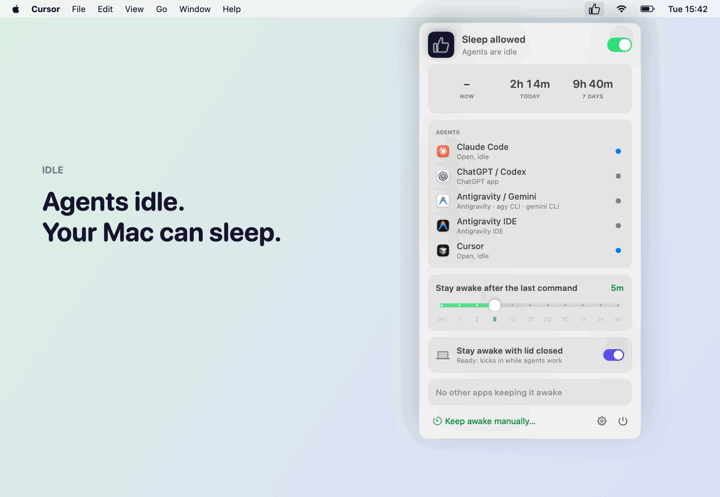
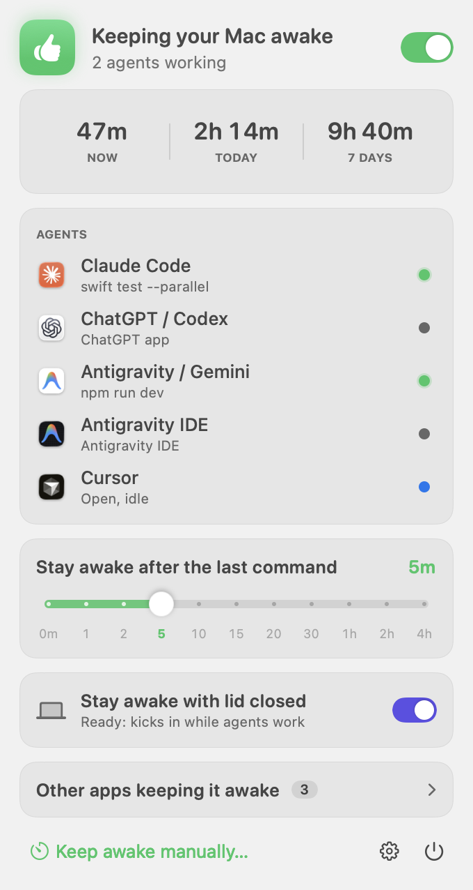
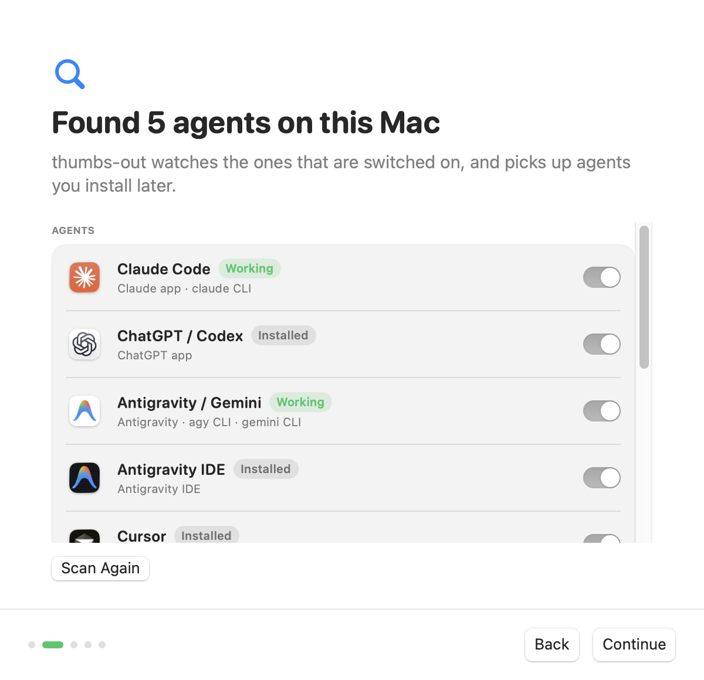
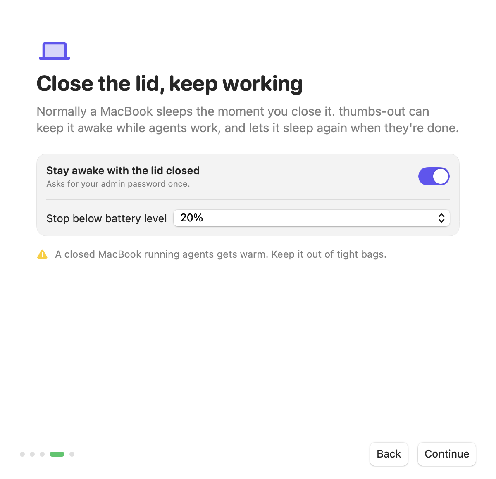
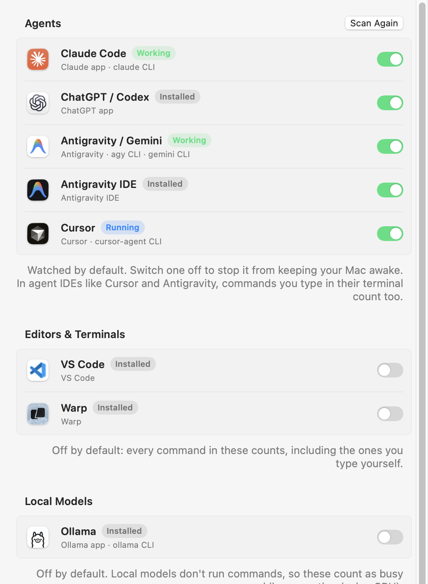

# 👍 thumbs-out

**Keep your Mac awake while your AI agents work.** No more walking around with a half-open MacBook
so Claude Code, Codex, Cursor or Antigravity can finish the job.

thumbs-out is a small macOS menu bar app that notices when coding agents are running commands and
keeps the Mac awake until they're done. Think Amphetamine, but automatic. It can even keep working
with the lid closed.

<p align="center">
  
</p>

**[Website](https://mj0lken.github.io/thumbs-out/)** ·
**[Download for Apple Silicon](https://github.com/mj0lken/thumbs-out/releases/latest)** ·
**[Check compatibility](https://mj0lken.github.io/thumbs-out/#compat)** · macOS 15 or later · free
and open source (MIT)

## Install

**Homebrew:**

```bash
brew install --cask mj0lken/tap/thumbs-out
```

**Or download it:**

1. Download `thumbs-out-…-arm64.zip` from the
   [latest release](https://github.com/mj0lken/thumbs-out/releases/latest), unzip it, and drag
   **thumbs-out.app** to **Applications**.
2. Open it (also after a Homebrew install). The app isn't signed with a paid Apple Developer ID yet, so macOS stops it the first
   time: click **Done**, open **System Settings › Privacy & Security**, scroll down and click
   **Open Anyway** next to thumbs-out. You only do this once.
3. The welcome window walks you through which agents were found, the grace period, lid-closed mode
   and launch at login.

Not sure your Mac qualifies? The [compatibility check](https://mj0lken.github.io/thumbs-out/#compat)
looks at your chip and macOS version in the browser, or run `sw_vers -productVersion; uname -m` in
Terminal: you need 15 or higher, and `arm64`.

Prefer to build it yourself? See [Build and run](#build-and-run).

<p align="center">
  
  &nbsp;
  
  &nbsp;
  
</p>

## What it watches

| Tier | Entries | Default |
|------|---------|---------|
| **Agents** | Claude Code (CLI, npm, Claude desktop app's Code tab, IDE extensions), ChatGPT / Codex, Antigravity / Gemini CLI, Antigravity IDE, Cursor (app + `cursor-agent`), Windsurf, Kiro, GitHub Copilot CLI, OpenCode, Aider, Goose, Amp, Factory Droid, Qwen Code, Crush | On |
| **Editors & terminals** | VS Code (Copilot, Cline and other extensions), Zed, Warp | Off: every command typed in them counts too |
| **Local models** | Ollama, LM Studio | Off: counted as busy while generating, by CPU use |

The list is a data-driven catalog in `Sources/ThumbsOutCore/Agent.swift`; supporting a new agent is
one entry (process names, app bundle, CLI names). Commands are credited to the innermost agent, so
Claude Code running inside VS Code counts as Claude Code, and an idle agent session sitting in a
terminal doesn't count as a running command.

## How it works

Every few seconds thumbs-out looks at the process tree under each agent:

- **Command shells** (`zsh -c …`, `bash -lc …`) exist only while a command is running. That's how
  Claude Code and Codex run commands.
- **Interactive shells** (Antigravity's terminal) count when they have a child process, meaning a
  command is running in the terminal.
- **MCP servers** and other long-lived helpers (`npx`, `uvx`, anything with `mcp` in its arguments,
  prompt helpers like `gitstatusd`) are skipped so they don't keep the Mac awake forever.

While anything is running, it holds an IOKit `PreventUserIdleSystemSleep` assertion (or
`PreventUserIdleDisplaySleep` if you choose to keep the display on). That's the same mechanism
Amphetamine and `caffeinate` use. After the last command it waits for a **grace period** (5 minutes
by default) so the Mac stays awake while the agent thinks between commands.

## First launch

A five-step welcome window: what thumbs-out does, which agents it found (and whether to watch
each), the grace period, lid-closed mode and launch at login. It shows once; Settings › General ›
**Show Welcome Again…** reopens it.

Agents are found by looking for their apps (`/Applications`, `~/Applications`, and Launch Services
by bundle ID) and command-line tools (`claude`, `codex`, `agy` in `~/.local/bin`, Homebrew,
`/usr/local/bin`, npm, bun and nvm locations). Each agent shows as **Working**, **Running**,
**Installed** or **Not found**. Agents installed later are picked up automatically.

## Menu bar panel

- **Status header**: whether the Mac is being kept awake and why, plus the master switch
- **Time kept awake**: the current stretch, today and the last 7 days
- **Agents**: each agent with its app icon, what it's running, and a status dot (pulses while working)
- **Grace period meter**: snaps to 0m, 1, 2, 5, 10, 15, 20, 30 min, 1h, 2h, 4h; while a grace period
  counts down, the time left shows as an amber bar
- **Stay awake with lid closed**: lid-closed mode switch and what closing the lid would do right now
- **Other apps keeping it awake**: everything else holding a keep-awake lock (same data as
  `pmset -g assertions`), collapsed by default
- **Keep awake manually…**: 15 minutes, 1, 2 or 5 hours, or until you stop it; [Report a bug](#report-a-bug), Settings and Quit

## Lid-closed mode

Power assertions don't survive closing the lid. Apple's docs say the system "may still sleep for
lid close". The only switch that stops lid sleep is the system-wide, root-only `SleepDisabled`
setting (`pmset -a disablesleep 1`).

Lid-closed mode is off by default. Turning it on the first time asks for your admin password once and installs
`/etc/sudoers.d/thumbs-out`. That rule lets your account run exactly two commands without a
password: `pmset -a disablesleep 0` and `pmset -a disablesleep 1`. After that, thumbs-out turns lid
sleep off only while it's keeping the Mac awake, and turns it back on:

- when agents finish and the grace period ends,
- when the battery drops below a threshold (20% by default),
- when you quit,
- within about 5 seconds if the app crashes or is killed (a small watchdog process),
- on the next launch, if a previous run left it off.

It never turns off a `SleepDisabled` that something else turned on. **Remove Lid-Closed Setup…** in Settings
turns lid sleep back on and deletes the rule. A closed MacBook running agents gets warm, so don't
put it in a bag with poor airflow.

## Settings



One scrolling page: **Agents** (found/covered, watch toggles, scan again), **Keeping Awake**
(master switch, grace period meter, display), **Lid Closed** (switch, battery threshold, removal),
**Time Kept Awake** (today, 7 and 30 days, all time, longest stretch, reset), **Detection** (poll
interval, ignored processes) and **General** (launch at login, show welcome again).

Awake time is counted between detection ticks while thumbs-out holds its lock; gaps longer than
about two poll intervals (the Mac slept anyway) aren't counted. Daily totals are kept for 30 days.

<br clear="right">

## Build and run

Requires an Apple Silicon Mac with macOS 15+, and Xcode (Swift 6) to build.

```bash
./scripts/build-app.sh            # builds build/thumbs-out.app
./scripts/build-app.sh --install  # also copies it to /Applications and launches it
swift test                        # runs the core tests
swift build && .build/debug/ThumbsOut --render-snapshots /tmp/snaps   # PNGs of every screen (debug only)
.build/debug/ThumbsOut --render-demo docs/images   # demo GIF (debug only)
.build/debug/ThumbsOut --render-site docs/images   # tour panels, app icon, social preview (debug only)
```

For **Launch at login** to work reliably, install the app to `/Applications` first. macOS may ask
you to approve it under System Settings › General › Login Items.

Check what it's doing:

```bash
pmset -g assertions | grep thumbs-out
pmset -g | grep -i sleepdisabled
```

## Compatibility

- **Apple Silicon only** (arm64). Intel Macs aren't supported.
- **macOS 15 Sequoia or later**: the releases Apple still ships security updates for (27, 26 and 15).
  The audience keeps their Macs current, so older releases aren't worth the untested surface.
- **MacBooks and desktop Macs.** Without a lid (mini, Studio, iMac), lid-closed mode is hidden
  everywhere and skipped in onboarding; **Remove Lid-Closed Setup…** stays reachable if it was set
  up before. No battery means no battery threshold. Not yet tested on desktop hardware.
- **MacBook Air** is fanless and heats up faster with the lid closed; the same heat warning applies.

Developed and tested on an M4 Pro MacBook Pro running macOS 26.

## Limitations

- In Antigravity, *any* command running in its integrated terminal counts, including ones you
  started yourself.
- Cloud-only agents (ChatGPT agent mode, Codex cloud tasks) run on remote servers, so there's no
  local process to detect.
- Without lid-closed mode, closing the lid sleeps the Mac unless it's in Apple's clamshell mode
  (power adapter plus external display).

## Report a bug

Click **Report a Bug…** in the menu panel (or in Settings › General), pick what went wrong (Mac
didn't stay awake, won't sleep, agent not detected, lid-closed mode, quit unexpectedly, something
else), add a line if you like, and click **Open GitHub Issue…**. Your browser opens a new
[issue](https://github.com/mj0lken/thumbs-out/issues) with the title, your answer and the details
below already filled in; check it and click **Create**. Nothing is sent before that, and the window
shows everything it adds first:

- **thumbs-out**: version, build, where it runs from, how long it has been running, and how many
  crash reports it left (not their contents; **Show in Finder** if you want to attach them)
- **This Mac**: macOS version, model identifier (`Mac16,7`), chip, lid, power source and battery
  level, and whether your account is an administrator (lid-closed setup needs one)
- **Setup and permissions**: the lid-closed sudoers rule, the `SleepDisabled` switch and who set
  it, what closing the lid would do, launch at login, and the last lid-closed error
- **Right now**: why the Mac is or isn't kept awake, the *programs* agents are running (`swift`,
  `npm`, never their arguments), which agents are open, and the names of other apps keeping it awake
- **Settings**, **agents found** and where they're installed (only for standard install folders),
  and thumbs-out's own log from this run

Never included: other processes, command arguments, file contents, personal folder names, the
serial number, host name or network details. Your home folder shows as `~` and your name as
`<user>`; what you type goes in as written. A report too long for a link goes through the clipboard
instead.

## Project layout

```
Sources/ThumbsOutCore/   pure logic: agent detection, keep-awake and lid policies, sudoers rule (unit-tested)
Sources/ThumbsOut/       menu bar app: libproc, IOKit assertions and power state, lid controller, SwiftUI
Tests/                   Swift Testing suites for the core
scripts/build-app.sh     packages the SwiftPM binary into a signed .app
```

## License

[MIT](LICENSE)
